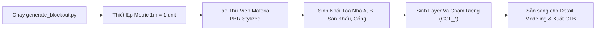

# QUY CHUẨN LƯỚI & HƯỚNG DẪN BLOCKOUT 3D (BLENDER $\rightarrow$ WEBGL)
**Dự án:** EDUVERSE 3D  
**Phong cách:** Style C -- Stylized Realistic  
**Kịch bản tự động hóa:** [`assets/school/generate_blockout.py`](../../assets/school/generate_blockout.py)

---

## 1. Giới Thiệu & Cách Sử Dụng Script Trong Blender

Kịch bản `generate_blockout.py` được thiết kế độc lập, sử dụng API cấp thấp `bmesh` để tạo hình học chính xác theo tỷ lệ 1:1 từ dữ liệu ảnh khảo sát trường học thực tế (Trường TH&THCS Vĩnh Thực).



### Cách 1: Chạy trực tiếp trong giao diện Blender
1. Mở Blender (phiên bản khuyến nghị: 3.3 LTS, 3.6 LTS hoặc 4.x).
2. Chuyển sang thẻ tab **Scripting** ở thanh menu trên cùng.
3. Bấm **Open** và chọn file:  
   `d:\ANTIGRAVITY\EDUVERSE_3D\assets\school\generate_blockout.py`
4. Bấm nút **Run Script** (hoặc phím tắt `Alt + P`).
5. Toàn bộ khuôn viên tỷ lệ thực sẽ lập tức xuất hiện trong 3D Viewport với vật liệu màu sắc Stylized trực quan.

### Cách 2: Chạy tự động qua dòng lệnh (Headless/CLI)
Nếu có cài đặt Blender trong Command Line:
```bash
blender --python d:\ANTIGRAVITY\EDUVERSE_3D\assets\school\generate_blockout.py
```

---

## 2. Quy Chuẩn Kích Thước 1:1 (Scale & Coordinate Standards)

- **Hệ tọa độ:**
  - $Z$ hướng lên (Up Axis).
  - Tọa độ gốc $(0, 0, 0)$: Nằm tại trung tâm mặt sân trường chính.
  - Trục $+Y$: Hướng Bắc (về phía Tòa nhà B và đồi núi).
  - Trục $-X$: Hướng Tây (dọc theo chiều dài Tòa nhà A - 3 tầng).
  - Trục $+X$: Hướng Đông (về phía Cổng trường chính).

| Khu vực / Công trình | Kích thước (X × Y × Z) | Tọa độ tâm $(X, Y, Z)$ | Đặc điểm nhận diện kiến trúc (Chuẩn hóa 1:1 Google Maps `@21.3712629,107.9043412`) |
| :--- | :--- | :--- | :--- |
| **Bản đồ gốc (`REF_GoogleMaps_Satellite_1to1`)** | $81.3\text{ m} \times 92.6\text{ m}$ | $(-5.37, -4.08, -0.24)$ | Ảnh vệ tinh lót đáy tỉ lệ 1:1 ($0.1126\text{ m/px}$), góc phương vị $+25.33^\circ$ |
| **Sân trường đa giác (`ENV_Courtyard_Ground`)** | Đa giác 10 đỉnh ôm tường bao | $(-3.0, -4.0, -0.10)$ | Bê tông phẳng bám sát tường phễu Tây-Nam dẫn ra Cổng trường |
| **Tòa nhà A (`BLD_A_EastWing_3F`)** | $8.6\text{ m} \times 52.0\text{ m} \times 10.8\text{ m}$ | $(18.55, -6.20, 5.40)$ | 3 tầng (10 phòng học), sảnh đón mái bằng, cầu nối góc Đông-Bắc sang Tòa B |
| **Nhà phụ sau Tòa A (`BLD_A_RearAnnex`)** | $6.2\text{ m} \times 15.5\text{ m} \times 3.8\text{ m}$ | $(26.00, -2.00, 1.90)$ | 1 tầng mái xanh nhạt áp lưng Tòa A chuẩn ảnh vệ tinh |
| **Tòa nhà B - Tòa chính (`BLD_B_NorthWing_2F`)** | $31.6\text{ m} \times 8.2\text{ m} \times 7.3\text{ m}$ | $(2.40, 29.35, 3.65)$ | 2 tầng phía Bắc đầu Tòa A, đồng hồ tròn, pano Bác Hồ & 2 khẩu hiệu xanh |
| **Sân khấu chào cờ (`BLD_B_Stage`)** | $9.4\text{ m} \times 5.6\text{ m} \times 0.65\text{ m}$ | $(1.40, 22.45, 0.325)$ | Đúng tâm vệ tinh $X=1.4\text{m}$, mái che 2 trụ tròn, 5 cờ đỏ & thảm đỏ |
| **Tòa nhà C2 - Nhà phụ trợ (`BLD_C2_Annex`)** | $8.2\text{ m} \times 26.0\text{ m} \times 6.8\text{ m}$ | $(-28.00, 15.20, 3.40)$ | 2 tầng mái ngói đỏ cánh Tây, sân sau & tường gạch nối thẳng lưng Tòa B ($Y=33.45\text{m}$) |
| **Tòa nhà C1 - Nhà Đa Năng (`BLD_C1_Gymnasium`)** | $25.0\text{ m} \times 14.2\text{ m} \times 7.4\text{ m}$ | $(-32.00, -5.00, 3.70)$ | **Xoay ngang Đông-Tây**, mái 2 dốc đỏ đô viền sê-nô trắng, sảnh 2 trụ hướng Nam |
| **Lán để xe học sinh (`BLD_C3_BikeShed`)** | $15.5\text{ m} \times 5.2\text{ m} \times 2.75\text{ m}$ | $(-28.50, -18.60, 1.38)$ | Mái tôn xanh phía Nam Nhà Đa Năng kèm dàn xe đạp học sinh |
| **2 Bồn hoa dọc & 2 Ô cỏ ngang sân trường** | $11.5\times4.6\text{ m}$ & $10.8\times9.6\text{ m}$ | $(-7.2, -2.0)$ & $(-7.3, -14.2)$ | Khớp từng mét bó vỉa trắng trên ảnh vệ tinh Google Maps + trạm kỹ thuật trắng |
| **Tòa nhà D - Hiệu Bộ (`BLD_D_Admin_3F`)** | $17.5\text{ m} \times 10.0\text{ m} \times 10.2\text{ m}$ | $(35.50, 25.50, 5.10)$ | 3 tầng **quay hướng Nam**, 2 bảng khẩu hiệu đỏ tầng 2 + nhà phụ 1 tầng bên Đông |
| **Vườn cảnh quan Đông (`ENV_EastGarden`)** | $19.5\text{ m} \times 27.5\text{ m} \times 0.25\text{ m}$ | $(35.80, -18.50, 0.12)$ | Thảm cỏ lớn kèm đường dạo chữ thập & bùng binh tròn đồng tâm chuẩn vệ tinh |
| **Cổng chính & Nhà bảo vệ (`BLD_Gate`)** | Cổng $8.8\text{ m}$ + Bảo vệ $3.6\times3.6\text{ m}$ | $(8.40, -40.00, 2.25)$ | Giáp trục đường liên thôn Vĩnh Thực, tường rào gấp khúc hình phễu Tây-Nam |

---

## 3. Ngân Sách Đa Giác & Tối Ưu Hiệu Năng WebGL (Polygon Budget)

Để đảm bảo Website và PWA chạy ổn định ở mức **60 FPS** ngay cả trên điện thoại di động:

```text
┌──────────────────────────────────────────────────────────────┐
│ TỔNG NGÂN SÁCH POLYGON (TOÀN BỘ KHUÔN VIÊN): < 25,000 TRIS   │
├──────────────────────────────────────────────────────────────┤
│ ├── Tòa nhà A (3 tầng chi tiết + mái + ban công):  ~6,000    │
│ ├── Tòa nhà B (2 tầng + sân khấu + mái dốc):      ~4,500    │
│ ├── Cổng trường + Hàng rào + Nhà phụ trợ:         ~2,000    │
│ ├── Sân trường + Bồn hoa + Ghế đá (Props):        ~2,500    │
│ ├── Cây cối (Low-poly Stylized dùng Instancing):  ~3,000    │
│ └── Hậu cảnh (Đồi núi + Tháp ăng-ten):            ~1,000    │
└──────────────────────────────────────────────────────────────┘
```

### Các nguyên tắc vàng khi dựng chi tiết:
1. **Không dùng Subsurf Modifier:** Phong cách Style C chú trọng hình khối dứt khoát; các cạnh bo góc chỉ cần dùng **Bevel 1 phân đoạn (1 Segment)** với `Harden Normals` bật để tạo phản chiếu viền đẹp mà không tăng số lượng face.
2. **Modular Instancing:** Các ô cửa sổ lớp học ($2.4\text{ m} \times 1.8\text{ m}$) và lan can chỉ dựng 1 module gốc (Asset Module), sau đó nhân bản (Alt+D trong Blender hoặc `<Instances>` trong React Three Fiber).
3. **Layer Va Chạm Riêng Biệt (`COL_*`):**
   - Trong script đã tạo sẵn Collection `EDUVERSE_Collision_Hulls`.
   - Các mesh va chạm này là các hộp tối giản (Box Collider) bao bọc công trình và mặt sân.
   - Khi đưa vào Three.js, chỉ truyền layer này vào thư viện `three-mesh-bvh` hoặc Octree. Không dùng mesh kiến trúc chi tiết để tính toán va chạm.

---

## 4. Bảng Tra Mã Màu & Vật Liệu Stylized (Palette Reference)

| Tên Material | Mã Màu Hex | Thông số PBR | Công năng sử dụng |
| :--- | :--- | :--- | :--- |
| `MAT_Wall_Yellow` | `#F6E8AC` | Roughness: `0.75`, Metallic: `0.0` | Tường chính các tòa nhà và trụ cổng |
| `MAT_Accent_Orange` | `#E08E45` | Roughness: `0.60`, Metallic: `0.0` | 2 cột sảnh chính Tòa A, viền mái che |
| `MAT_Trim_White` | `#F2F2F2` | Roughness: `0.50`, Metallic: `0.0` | Phào chỉ, viền sàn ban công, bậc tam cấp |
| `MAT_Roof_RedTile` | `#D35439` | Roughness: `0.70`, Metallic: `0.0` | Mái dốc ngói nung đỏ |
| `MAT_Yard_Concrete` | `#D8D8D8` | Roughness: `0.85`, Metallic: `0.0` | Mặt sân bê tông |
| `MAT_Metal_Inox` | `#CCCCCC` | Roughness: `0.25`, Metallic: `0.85` | Lan can ban công inox |
| `MAT_Glass_Dark` | `#1A222B` | Roughness: `0.15`, Metallic: `0.20` | Kính cửa sổ và cửa đi phòng học |
| `MAT_Stage_RedCarpet` | `#C0262D` | Roughness: `0.90`, Metallic: `0.0` | Thảm đỏ sân khấu, biển khẩu hiệu |
| `MAT_Bench_RedStone` | `#A64436` | Roughness: `0.70`, Metallic: `0.0` | Ghế đá mài đỏ nung sân trường |
| `MAT_Vegetation_Green` | `#4F7942` | Roughness: `0.80`, Metallic: `0.0` | Bồn hoa, thảm cỏ, tán cây |

---

## 5. Phiên Bản Siêu Chi Tiết v6 (Masterpiece Hyper-Detail Edition)

Phiên bản `v6` đã bổ sung trọn vẹn toàn bộ các chi tiết kiến trúc, con người và lễ hội từ 4 ảnh chụp thực địa và video drone flycam:

1. **Khối Nhà & Kiến Trúc Bổ Sung:**
   - **Tòa nhà A (3 tầng):** Bổ sung cổng vòm màu mơ thứ hai ở nhịp thang Bắc, nội thất đầy đủ (bảng đen, bàn giáo viên, bàn ghế 2 hàng), cụm dàn nóng điều hòa mặt sau, ống thoát nước mưa PVC trắng, biển tên lớp học ("Lớp 9A", "Lớp 8A"...), bảng tin trường mái đỏ.
   - **Tòa nhà B (2 tầng):** Sân khấu lễ hội có 5 cờ đỏ viền mái che, phông nền hoa sen xanh, bục phát biểu gỗ, hàng chậu hoa cúc vàng, cặp tùng tháp, dàn loa thùng biểu diễn trên chân tripod, bàn đại biểu VIP khăn nhung đỏ kèm ghế xanh, chòi âm thanh có dù che nắng.
   - **Nhà Đa Năng C1:** Mặt đứng hướng Nam có sảnh đón cửa kính lớn, bậc tam cấp, các hàng cửa sổ lấy sáng trên cao và huy hiệu thông gió hình tròn đỉnh hồi mái.
   - **Tòa nhà Hiệu Bộ D (3 tầng):** Nằm phía sau Cánh Phải kèm sân phụ lát bê tông và bồn hoa tròn cảnh quan trung tâm.
2. **Con Người & Hoạt Cảnh Sân Trường (Human Characters & Props):**
   - Đội hình học sinh Việt Nam áo polo xanh dương, khăn quàng đỏ xếp hàng ngay ngắn trên sân.
   - Hàng ghế nhựa đỏ học sinh xếp thẳng hàng.
   - Đội trống nghi thức măng non áo trắng viền đỏ, đeo trống đội vàng trên thảm đỏ.
   - Dây cờ đuôi nheo tam giác nhiều màu (hồng, xanh ngọc, vàng, xanh lá, tím, đỏ) chăng ngang trời.
3. **Multi-Camera & Render Previews:**
   - [`docs/preview_aerial_overview.png`](file:///d:/ANTIGRAVITY/EDUVERSE_3D/docs/preview_aerial_overview.png): Toàn cảnh góc Flycam Drone Frame 025.
   - [`docs/preview_ground_ceremony.png`](file:///d:/ANTIGRAVITY/EDUVERSE_3D/docs/preview_ground_ceremony.png): Góc cận sân trường giờ chào cờ khớp Ảnh 4.
   - [`docs/preview_stage_front.png`](file:///d:/ANTIGRAVITY/EDUVERSE_3D/docs/preview_stage_front.png): Góc chính diện lễ đài sân khấu khớp Ảnh 3.

---

## 6. Phiên Bản v8 — Nhận Diện & Dựng Chi Tiết Từ 3 Ảnh Cận Cảnh Mặt Đất

Ba ảnh khảo sát cận cảnh mặt đất được sao lưu tại [`docs/ref_photo_bld_c2.jpg`](file:///d:/ANTIGRAVITY/EDUVERSE_3D/docs/ref_photo_bld_c2.jpg), [`docs/ref_photo_bld_b_stage.jpg`](file:///d:/ANTIGRAVITY/EDUVERSE_3D/docs/ref_photo_bld_b_stage.jpg) và [`docs/ref_photo_playground_gym.jpg`](file:///d:/ANTIGRAVITY/EDUVERSE_3D/docs/ref_photo_playground_gym.jpg) đã được bóc tách và dựng chi tiết 1:1:

1. **Ảnh 1 (`ref_photo_bld_c2.jpg`) — Tòa C2 (`BLD_C2_Annex`, Dãy nhà 2 tầng cánh Tây):**
   - Kết cấu 2 tầng, 9 cột vuông suốt 2 tầng chia thành **8 nhịp (bays)**, sàn mái bằng đua rộng đỡ mái ngói đỏ.
   - Nhịp giữa có **bậc tam cấp 5 bậc lát đá granite đỏ hồng**, cửa đi chính 4 cánh khung trắng có pano dưới, và băng rôn đỏ chữ vàng tầng 2: *"DÙ KHÓ KHĂN ĐẾN ĐÂU CŨNG PHẢI THI ĐUA DẠY TỐT, HỌC TỐT"*.
   - Các nhịp phòng học lắp **cửa sổ 4 cánh khung trắng** có ô thoáng trên; nhịp thứ 2 từ phải sang là **ô cầu thang bộ**; trên mái góc Bắc đặt **bồn nước Inox Sơn Hà nằm ngang** (`PROP_C2_WaterTank_Inox`); dưới chân công trình là dải bồn hoa xây gạch thấp trồng cây cảnh.
2. **Ảnh 2 (`ref_photo_bld_b_stage.jpg`) — Tòa B (`BLD_B_NorthWing_2F`) & Sân Khấu Lễ Đài (`BLD_B_Stage`):**
   - **Lễ đài chào cờ:** Bậc tam cấp **7 bậc lát gạch đỏ** bao 3 mặt (trước, trái, phải); **2 trụ tròn màu vàng** có đế vuông đỡ mái bằng lắp **2 đèn ốp trần tròn**; diềm đỏ chữ vàng *"QUẢN LÝ TỐT - DẠY TỐT - HỌC TỐT"*; 1 cột cờ chính giữa + 6 lá cờ đỏ cắm nghiêng và **2 loa phóng thanh** trắng gắn cột tầng 2.
   - **Tầng 1 & Tầng 2 Tòa B:** Phía sau sân khấu tầng 1 bên trái là gầm cầu thang lắp **cửa sắt xếp màu xanh lá** (`BLD_B_FoldingGate_Green`), bên phải là cửa đi 2 cánh trắng và bảng biểu; hành lang tầng 1 dùng **con tiện trắng**, tầng 2 dùng **lan can sắt thanh đứng** với **đầu cột chữ T trắng**; chính giữa tầng 2 treo **Pano đôi khung vàng** (trái: Bác Hồ với thiếu nhi, phải: Thư Bác Hồ nền vàng) và **2 băng khẩu hiệu nền xanh dương** sát diềm mái (*"Vì lợi ích mười năm thì phải trồng cây"* / *"Vì lợi ích trăm năm thì phải trồng người"*).
   - **Cảnh quan chân lễ đài:** **2 chậu cảnh gốm xanh dương đắp nổi họa tiết vàng** (`PROP_OrnateBluePlanter_L/R`) đặt ở hai góc bậc tam cấp cùng hàng cây tùng bách tán dọc hành lang.
3. **Ảnh 3 (`ref_photo_playground_gym.jpg`) — Khu Vui Chơi Vận Động Trên 2 Ô Cỏ Ngang & Mặt Đông Nhà Đa Năng (`BLD_C1`):**
   - **Khu vui chơi vận động ngoài trời (`ENV_GrassPlot_1` & `ENV_GrassPlot_2`):** Bó vỉa bê tông vàng-trắng viền cây bụi thấp, trang bị **khung leo vận động lập phương đa sắc** (xanh, vàng, đỏ), **thang leo cầu vồng bán nguyệt**, **nhà cầu trượt liên hoàn mái chóp nón vàng**, **dàn thú nhún lò xo** (xanh, vàng, đỏ), khung xà đu và **2 cây bàng Đài Loan non có 3 cọc gỗ chống**.
   - **Mặt Đông Nhà Đa Năng (`BLD_C1_Gymnasium`):** Chân tường sơn vàng đậm (`Wall_OchreBase`), 4 trụ pilaster trắng chia 3 nhịp; nhịp giữa nhô ra **sảnh phụ ốp đá granite nâu vàng** (2 cột vuông + dầm ngang + bậc tam cấp đá xám + cửa đôi tối màu) kèm 2 cửa sổ ngang phía trên; 2 nhịp bên bố trí **cửa sổ lớn 3 cánh khung tối viền trắng** và cửa sổ chớp ngang sát diềm mái, kèm ghế đá và ống thoát nước mưa PVC.
