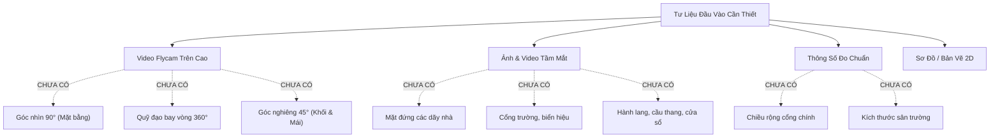

# EDUVERSE 3D -- Thiết Kế Kiến Trúc Kỹ Thuật & Kế Hoạch Triển Khai

> [!IMPORTANT]
> **Trạng thái cốt lõi hiện tại:** Dự án chưa nhận được tư liệu ảnh/video thực tế của trường (dự kiến là Trường TH&THCS Vĩnh Thực). Theo nguyên tắc dự án, **chưa triển khai mã nguồn chi tiết hay dựng mô hình phỏng đoán** mà tập trung chuẩn hóa quy trình, thiết lập kiến trúc kỹ thuật và chuẩn bị sẵn sàng cho Giai đoạn 1 (Khảo sát & Mặt bằng).

---

## 1. Phân Tích Yêu Cầu & Bảng Đánh Giá Dữ Liệu

### 1.1. Ma trận yêu cầu hệ thống

| Hạng mục | Yêu cầu kỹ thuật | Giải pháp kỹ thuật | Ghi chú |
| :--- | :--- | :--- | :--- |
| **Đối tượng tái tạo** | Trường học thực tế, không dùng mẫu generic | Tái tạo theo tỷ lệ 1:1 từ video flycam & ảnh chụp thực tế | Cần xác nhận tên & ranh giới khuôn viên |
| **Phong cách đồ họa** | **Style C: Stylized Realistic** | Clean low/mid-poly, PBR texture atlas, baking ambient occlusion & lighting, giữ đúng đường nét kiến trúc thật | Vừa nhẹ cho trình duyệt, vừa thẩm mỹ như Roblox/Genshin |
| **Nền tảng mục tiêu** | Website + PWA (Desktop & Mobile) | WebGL 2.0 / WebGPU ready, Three.js / React Three Fiber, Service Worker cache | Hỗ trợ offline caching cho static assets |
| **Hiệu năng & Tải** | Chạy mượt mà 60 FPS trên máy tầm trung | LOD (Level of Detail), glTF/Draco/Meshopt, Texture Compression (KTX2/Basis) | Tổng dung lượng initial load < 25MB |
| **Mở rộng (Giai đoạn sau)** | 10--50 người chơi đồng thời (CCU) | Node.js + Socket.IO, State Snapshot Interpolation, Client-side Prediction | Không làm ngay ở Giai đoạn 1--3 |

### 1.2. Dữ liệu hiện trạng & Danh mục còn thiếu



> [!WARNING]
> **Rủi ro nếu dựng khi thiếu dữ liệu:** Việc tự suy đoán kích thước các khối nhà sẽ dẫn đến tỷ lệ sai lệch, phải đập đi dựng lại toàn bộ khi nhận ảnh thật.

---

## 2. Pipeline Dựng Mô Hình: Từ Flycam Đến WebGL

```mermaid
flowchart LR
    subgraph S1["1. Xử Lý Tư Liệu"]
        V["Video Flycam / Ảnh"] --> Ext["Trích xuất Frame 4K"]
        Ext --> Align["Căn chỉnh tỷ lệ & Mặt bằng 2D"]
    end

    subgraph S2["2. Sản Xuất Blender (Style C)"]
        Align --> Blockout["Dựng khối Blockout 1:1"]
        Blockout --> Mod["Dựng chi tiết Modular"]
        Mod --> Bake["UV Mapping & Bake Texture/AO"]
        Bake --> Opt["LOD & Gltfpack/Draco"]
    end

    subgraph S3["3. Tích Hợp Three.js / R3F"]
        Opt --> R3F["Load GLB + KTX2"]
        R3F --> Coll["Xây dựng BVH/Octree Collision"]
        Coll --> Controls["Camera & Player Controls"]
    end
```



### Chi tiết các bước kỹ thuật trong Pipeline:

1. **Trích xuất khung hình & Thiết lập Reference (Camera Match / fSpy):**
   - Trích xuất ảnh tĩnh chất lượng cao từ video flycam ở các góc chính: Top-down (mặt bằng), Isometric 45°, và Front-facing (mặt tiền).
   - Đưa ảnh vào **fSpy** hoặc **Blender Camera Calibration** để trích xuất tiêu cự (Focal Length) và phối cảnh chính xác.
2. **Khởi tạo thước chuẩn (Scale Anchor):**
   - Đặt đơn vị hệ mét (Metric: 1 Unit = 1 Meter) làm chuẩn tuyệt đối trên cả Blender và Three.js.
   - Chọn một vật chuẩn dễ xác định kích thước thực (ví dụ: chiều rộng cửa lớp học $0.9\text{ m} - 1.2\text{ m}$, chiều cao tầng $3.6\text{ m} - 3.9\text{ m}$, bậc thang $15\text{ cm} \times 30\text{ cm}$) để căn chỉnh toàn bộ khuôn viên.
3. **Dựng hình theo phong cách Stylized Realistic (Style C):**
   - **Triết lý:** Đơn giản hóa hình học chi tiết siêu nhỏ (bevels quá nhỏ, ốc vít, chấn song dày đặc), thay vào đó tạo khối dứt khoát, rõ nét, viền bo nhẹ hoặc đổ bóng góc cạnh đặc trưng.
   - Sử dụng phương pháp **Modular Design**: Các cửa sổ lớp học, ban công hành lang, bồn hoa, cột cờ, cây xanh được dựng thành các module lặp lại (instancing) giúp giảm thiểu số lượng draw calls trên trình duyệt.
4. **Tối ưu hóa Texture & Light Baking:**
   - Hạn chế sử dụng quá nhiều chất liệu PBR nặng (Roughness/Metalness/Normal maps độc lập cho từng viên gạch).
   - Sử dụng **Texture Atlas** (ghép chung texture tường, sàn, mái ngói vào 1--2 sheet $2048 \times 2048$).
   - Bake trước **Ambient Occlusion (AO)** và đổ bóng tĩnh vào Vertex Colors hoặc Lightmaps để đạt chất lượng thị giác cao mà không tốn tài nguyên tính toán dynamic shadow của GPU trên điện thoại.
5. **Định dạng xuất bản (GLTF/GLB Pipeline):**
   - Định dạng chuẩn: `.glb`.
   - Nén hình học: `Draco Compression` hoặc `Meshopt`.
   - Nén texture: `KTX2 / Basis Universal` giúp giảm 70% VRAM sử dụng trên thiết bị di động.

---

## 3. Danh Mục Tài Sản (Asset Inventory Blueprint)

Cấu trúc phân loại tài sản nhằm phục vụ cho việc quản lý mô hình và phân cấp va chạm (Collision Layer):

```text
EDUVERSE_ASSETS/
├── Architecture/ (Công trình kiến trúc)
│   ├── BLD_Main_BlockA      (Dãy phòng học chính - 2-3 tầng)
│   ├── BLD_Main_BlockB      (Dãy phòng học bộ môn / hiệu bộ)
│   ├── BLD_Gate_Signboard   (Cổng chính + biển tên trường Vĩnh Thực)
│   ├── BLD_Bike_Shed        (Nhà để xe học sinh / giáo viên)
│   └── BLD_Restrooms_Aux    (Khu phụ trợ / vệ sinh)
├── Landscape/ (Khuôn viên & Sân bãi)
│   ├── ENV_Ground_Yard      (Sân trường bê tông / gạch lá dừa)
│   ├── ENV_Ground_Perimeter (Tường bao & ranh giới trường)
│   ├── ENV_Flagpole_Stage   (Cột cờ & lễ đài sân trường)
│   └── ENV_Flowerbeds       (Bồn hoa, bệ cây quanh sân)
├── Vegetation/ (Thực vật - Stylized)
│   ├── VEG_Tree_Phoenix     (Cây phượng vĩ - hoa đỏ đặc trưng trường học)
│   ├── VEG_Tree_Banyan      (Cây bàng rợp bóng)
│   └── VEG_Bushes           (Bụi cây trang trí chân tường)
└── Props/ (Vật dụng tương tác & trang trí)
    ├── PROP_Benches         (Ghế đá sân trường)
    ├── PROP_TrashBins       (Thùng rác phân loại)
    └── PROP_Sport_Equip     (Cột bóng rổ, cầu môn mini nếu có)
```

### Quy ước đặt tên (Naming Convention):
- `BLD_` : Kiến trúc công trình (Building).
- `ENV_` : Mặt đất, sân, địa hình (Environment/Ground).
- `VEG_` : Cây cối, thực vật (Vegetation).
- `PROP_`: Đồ vật, trang trí (Props).
- `COL_` : Mesh va chạm đơn giản (Invisible Collision Hull - Box/Capsule/Convex, không dùng mesh render để tính va chạm).

---

## 4. Kiến Trúc Kỹ Thuật 3D Web & PWA

```mermaid
graph TB
    subgraph Client["EDUVERSE 3D Web Client (React + R3F)"]
        UI["UI Overlay (HTML/CSS + Tailwind)"]
        State["State Store (Zustand)"]
        
        subgraph Canvas3D["Canvas 3D (React Three Fiber)"]
            SceneMgr["Scene Manager & Lighting"]
            AssetLdr["Asset Loader (GLTF/KTX2)"]
            PhysEngine["BVH / Octree Collision"]
            PlayerCtrl["FPS/TPS Character Controller"]
        end
        
        UI <--> State
        State <--> Canvas3D
        PWA["Service Worker (Asset Offline Caching)"]
    end

    subgraph Backend["Multiplayer & Signaling (Giai đoạn 5)"]
        Srv["Node.js + Socket.IO Server"]
        Room["Room & Spatial Hash Grid"]
    end

    Canvas3D -.->|Socket Packets (10-20Hz)| Srv
```

### 4.1. Hệ thống xử lý va chạm & Di chuyển (Collision & Movement)
- **Vấn đề thường gặp:** Dùng trực tiếp mesh kiến trúc chi tiết để raycast va chạm sẽ gây sụt giảm khung hình nghiêm trọng khi nhân vật di chuyển.
- **Giải pháp:** Sử dụng **`three-mesh-bvh`** hoặc **Octree Collision**:
  - Tạo một layer mesh riêng (`COL_*`) với số polygon cực thấp (Low-poly invisible collider) chỉ để tính toán va chạm vật lý.
  - Hỗ trợ leo bậc thang mượt mà (smooth stair stepping) và trọng lực/nhảy tự nhiên.
- **Điều khiển (Controls):** Hỗ trợ song song:
  - Máy tính: `WASD` / Mũi tên + Di chuột xoay góc nhìn (PointerLockControls).
  - Điện thoại / Máy tính bảng: Phím ảo Dual Virtual Joystick (trái di chuyển, phải xoay góc nhìn).

### 4.2. Khả năng mở rộng Multiplayer (10--50 CCU)
- Khi bước vào Giai đoạn 5, hệ thống sẽ sử dụng:
  - **Tần số cập nhật vị trí:** 10--15 Hz (thay vì 60 Hz) để tiết kiệm băng thông.
  - **Dead Reckoning & Snapshot Interpolation:** Phía client tự nội suy vị trí của người chơi khác mượt mà dựa trên vận tốc và góc quay.
  - **Spatial Partitioning (Phân vùng không gian):** Chỉ đồng bộ người chơi trong cùng tầm nhìn hoặc cùng khu vực lớp học/sân trường.

---

## 5. Kế Hoạch Khảo Sát & Bảng Kiểm Nhận Dữ Liệu

Để bắt đầu Giai đoạn 1 và Giai đoạn 2 một cách chuẩn xác nhất, dự án cần các dữ liệu sau từ người dùng:

### Danh mục khảo sát cần thu thập (Checklist):

> [!TIP]
> Người dùng có thể cung cấp tư liệu qua Google Drive, OneDrive hoặc tải trực tiếp vào thư mục dự án khi có sẵn.

- [ ] **1. Video Flycam / Drone:**
  - [ ] Clip 1: Bay vuông góc thẳng từ trên đỉnh xuống (Nadir view - 90°) quét qua toàn bộ ranh giới khuôn viên.
  - [ ] Clip 2: Bay chậm quanh trường một vòng 360° với góc nghiêng khoảng 30°--45°.
  - [ ] Clip 3: Bay thấp lướt qua sân trước, sân sau và nóc các dãy nhà.
- [ ] **2. Ảnh chụp tầm mắt (Eye-level photos):**
  - [ ] Ảnh trực diện cổng chính, biển tên trường ("Trường TH&THCS Vĩnh Thực" hoặc tên chính xác).
  - [ ] Ảnh chụp chính diện và góc nghiêng của từng dãy nhà (thấy rõ màu sơn, số tầng, số ô cửa sổ, lan can).
  - [ ] Ảnh khu vực sân trường: Cột cờ, cây bàng/cây phượng, khu thể chất/nhà để xe.
- [ ] **3. Thông tin đo đạc chuẩn (Ước lượng hoặc thực tế):**
  - [ ] Ước lượng chiều dài x chiều rộng sân chính hoặc cổng trường (để làm mốc tỷ lệ 1:1).
