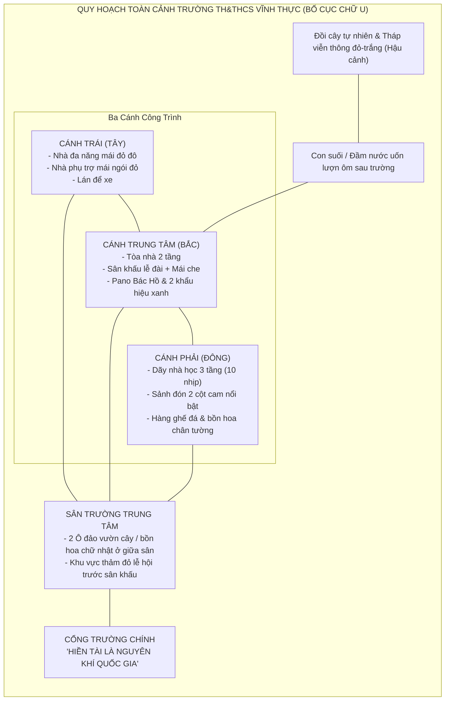

# BÁO CÁO PHÂN TÍCH QUY HOẠCH TOÀN CẢNH KHUÔN VIÊN TRƯỜNG HỌC (TỪ VIDEO FLYCAM)
**Dự án:** EDUVERSE 3D  
**Đối tượng khảo sát:** Trường TH&THCS Vĩnh Thực (xác nhận chính thức qua pano và video flycam)  
**Tư liệu phân tích:** 
- Video flycam gốc: `docs/school-blueprint/reference_videos/flycam_school_tour_1080p.mp4`
- 26 khung hình trích xuất: `docs/school-blueprint/video_frames/`

---

## 1. Phát Hiện Kiến Trúc Quan Trọng Từ Video Flycam

Qua trích xuất 26 khung hình flycam 1080p độ phân giải cao từ video, cấu trúc thực tế của trường là **BỐ CỤC HÌNH CHỮ U (U-SHAPED COMPLEX)** khép kín ôm trọn một sân trường trung tâm rộng lớn, chứ không chỉ là chữ L như các góc ảnh chụp trước:

---

## 2. Chi Tiết Từng Khối Công Trình

### 2.1. Cánh Phải: Dãy Nhà Học Chính 3 Tầng (`BLD_A_MainClassrooms_3F`)
- **Quy mô:** Dài $48\text{m}$, rộng $8.6\text{m}$, cao 3 tầng ($10.8\text{m}$).
- **Hành lang:** Hành lang mở chạy dọc suốt 3 tầng quay mặt vào sân trường, lan can inox sáng bóng.
- **Sảnh chính trung tâm:** Nhô ra phía sân trường $2.4\text{m}$ với **2 cột bê tông lớn sơn màu cam đất (`#E08E45`)** chạy suốt 3 tầng, có mái sảnh đón, bậc tam cấp rộng đón học sinh và bảng khẩu hiệu đỏ: *"Mỗi thầy giáo, cô giáo là một tấm gương đạo đức tự học và sáng tạo"*.
- **Mái:** Mái dốc 4 phía lợp ngói đỏ nung.
- **Chân tường:** Dải bồn hoa viền thấp và hàng 6 ghế đá mài màu đỏ gạch xếp thẳng hàng.

### 2.2. Cánh Trung Tâm: Khối Phòng Học & Sân Khấu Lễ Đài 2 Tầng (`BLD_B_FunctionHall_2F`)
- **Quy mô:** Dài $34\text{m}$, rộng $8.5\text{m}$, cao 2 tầng ($7.3\text{m}$).
- **Sân khấu lễ đài:** Bục bê tông rộng $9.4\text{m} \times 5.8\text{m}$ cao $0.65\text{m}$, có 2 cột tròn nâng mái che viền cam: *"QUẢN LÝ TỐT - DẠY TỐT - HỌC TỐT"*. Trên mặt sân khấu trải thảm đỏ và có thảm đỏ dẫn thẳng ra sân.
- **Pano tầng 2:** Khung tranh ảnh Bác Hồ quàng khăn đỏ cho học sinh, cột cờ Tổ quốc trên nóc mái che và hai bảng chữ xanh: *"VÌ LỢI ÍCH MƯỜI NĂM THÌ PHẢI TRỒNG CÂY"* - *"VÌ LỢI ÍCH TRĂM NĂM THÌ PHẢI TRỒNG NGƯỜI"*.
- **Lan can:** Tầng 1 dùng hàng con tiện bê tông trắng truyền thống, tầng 2 dùng lan can kim loại.

### 2.3. Cánh Trái: Nhà Đa Năng & Khối Nhà Phụ Trợ (`BLD_C_WestWing`)
- **Nhà Đa năng / Thể chất (`BLD_C1_Gymnasium`):**
  - Kích thước: $15\text{m} \times 26\text{m} \times 7.5\text{m}$.
  - **Mái dốc 2 mái màu đỏ mận/đỏ đô (`#A82436`)** rất đặc trưng, khác biệt hoàn toàn với mái ngói đỏ của các dãy phòng học.
  - Tường vàng kem, viền phào chỉ trắng, các ô cửa sổ kính lớn lấy sáng trên cao.
- **Khối nhà phụ trợ (`BLD_C2_Annex`):**
  - Dãy nhà 2 tầng mái ngói đỏ nằm tiếp giáp phía sau nhà đa năng.
- **Lán để xe (`BLD_C3_BikeShed`):** Mái che vòm màu xanh tôn cạnh nhà phụ.

### 2.4. Sân Trường Trung Tâm & Đảo Cây Xanh
- **2 Ô bồn hoa / Vườn cây chữ nhật lớn ($9.5\text{m} \times 12\text{m}$):** Nằm ở trục giữa sân trường, tạo luồng giao thông uốn quanh từ cổng chính dẫn vào khu vực sân khấu lễ đài.
- **Khu vực lễ hội:** Mặt sân bê tông phẳng, vạch sơn thể thao, vị trí trải thảm đỏ biểu diễn rộng rãi.

### 2.5. Cổng Trường & Hậu Cảnh Tự Nhiên
- Cổng chính lợp ngói đỏ nung, 2 trụ vuông lớn màu vàng, bảng tên: *"HIỀN TÀI LÀ NGUYÊN KHÍ QUỐC GIA"*.
- Hậu cảnh phía sau trường có con suối/đầm nước uốn lượn hình chữ U bao quanh gò đồi, trên đỉnh đồi có cột tháp viễn thông khung thép đỏ-trắng cao vút.
